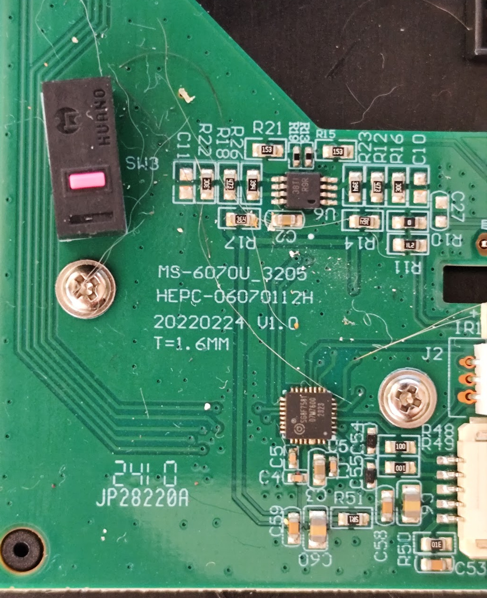
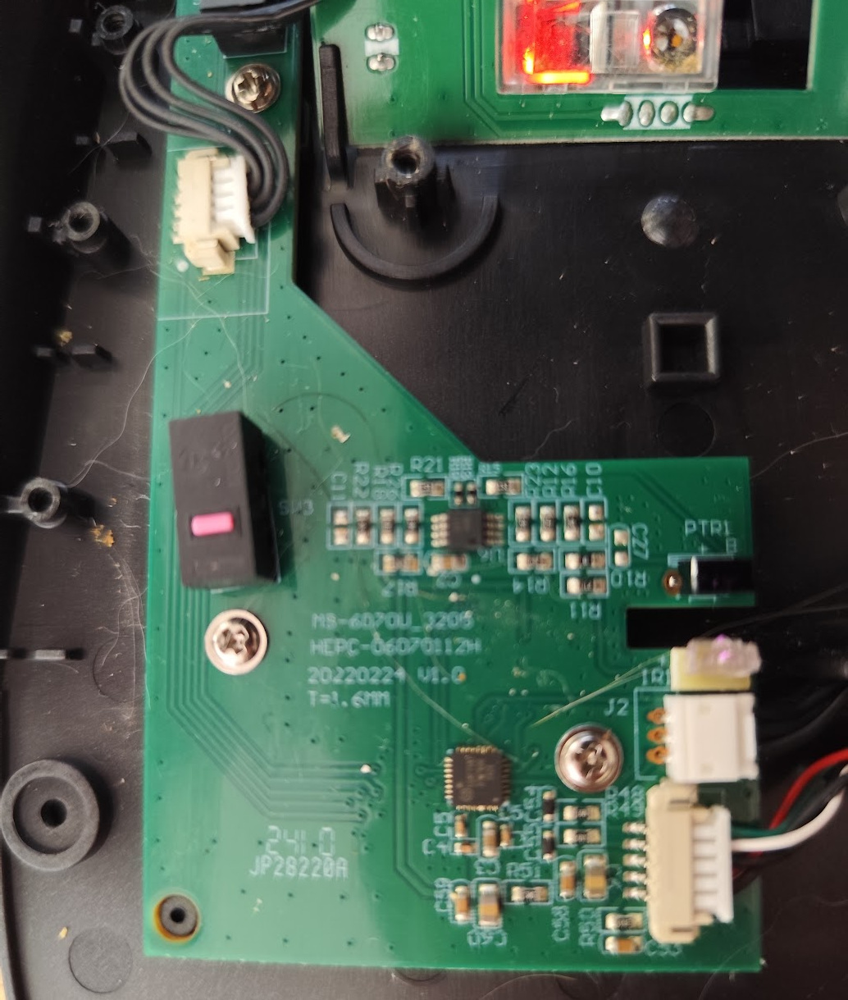
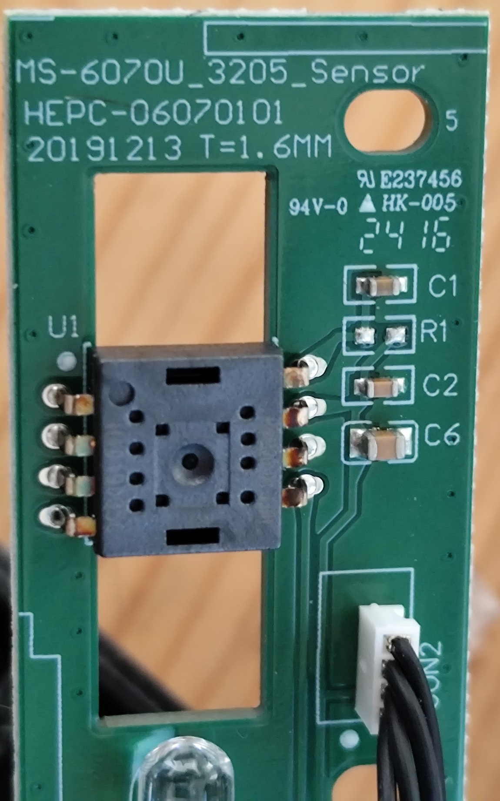
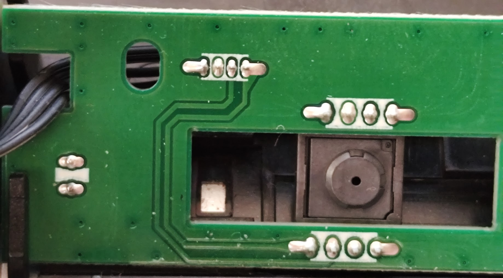

# Board photographs

The wired K64325 used for the V0114 firmware work. Photos supplied by the owner;
cropped, rotated, and compressed for this page. Click an image for full resolution.

## Main board

The controller is marked **SG8F7581**. The board carries the date and revision
`20220224 V1.0` and identifier `HEPC-06070112H`.

## Board layout

The main board and connected sensor board inside the lower housing.

## Sensor board, component side

The board carries identifier `HEPC-06070101` and date `20191213`. The optical
sensor's aperture faces the camera; its part number is not visible.

## Sensor board, reverse side

The reverse view shows the solder connections and the optical assembly through
the board opening.

